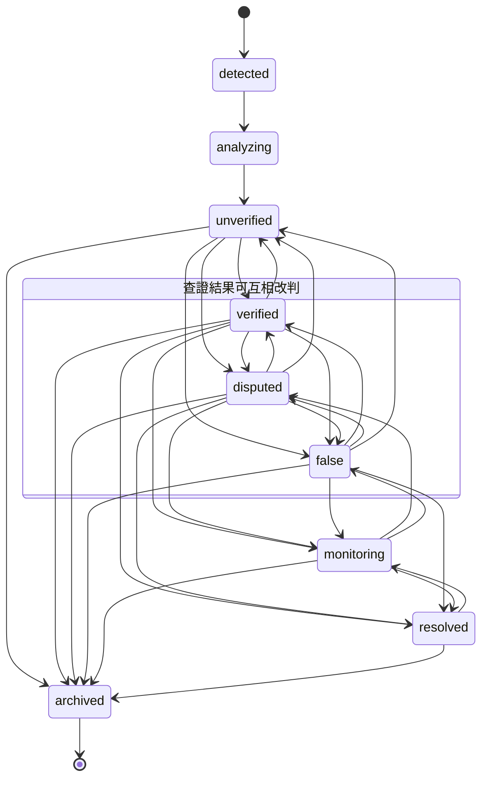
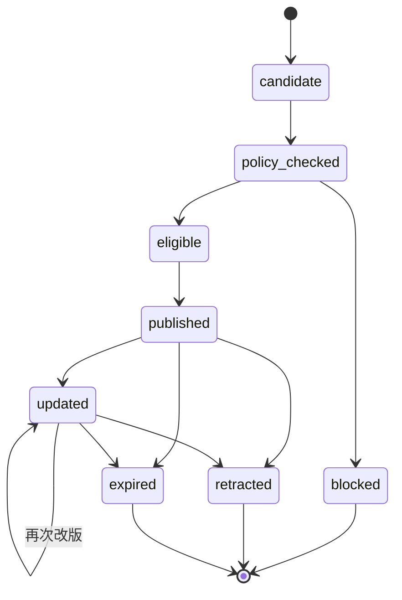

# 狀態機

事件、查證與警示的合法狀態與轉移。依據為規格 §6.3，以及 2026-10-17 使用者對規格未明確之處的決定（見文末）。

- 實作：`backend/app/domain/states.py`（`EventStatus`、`VerificationStatus`、`AlertState` 與轉移表）
- 測試：`backend/tests/unit/test_state_machines.py`：窮舉所有 (from, to) 組合，不在表中的一律必須拋出 `StateTransitionError`
- 所有狀態變更都必須經過 `transition(current, target)`，不得直接指定欄位值
- 狀態值以字串存入資料庫（`events.status` 等）；已使用的值不可改名，新增狀態需要 migration 與本文件同步更新

共通規則：

- **自我轉移一律非法**（例如 verified → verified），唯一例外是警示的 `updated → updated`（再次改版）。
- 不同狀態機的值不可混用：`EventStatus.VERIFIED` 與 `VerificationStatus.VERIFIED` 字串相同，但互相轉移會被拒絕。
- 終態（沒有任何合法的下一個狀態）：事件 `archived`；警示 `blocked`、`retracted`、`expired`。

## 事件（EventStatus）

初始狀態：`detected`

| 從 | 可轉移到 |
| --- | --- |
| detected | analyzing |
| analyzing | unverified |
| unverified | verified、disputed、false、archived |
| verified | unverified、disputed、false、monitoring、resolved、archived |
| disputed | unverified、verified、false、monitoring、resolved、archived |
| false | unverified、verified、disputed、monitoring、resolved、archived |
| monitoring | resolved、archived、disputed、false |
| resolved | monitoring、archived |
| archived | （終態） |

說明：

- `analyzing → unverified`：AI 分析完成後一律先進入未核實；證據不足時 abstain，也停在 unverified。
- 規格 A08：沒有 evidence_ids 的主張不得標記 verified。轉移表只保證狀態合法；這類業務條件由呼叫端（P2-T10 查證規則）檢查。
- `monitoring → disputed／false`：監看中出現矛盾證據或官方澄清（規格 A06）時可改判。

## 查證（VerificationStatus）

初始狀態：`unverified`。四個狀態之間可以互相轉移（不含自我轉移），代表有新證據時可以重新判定，沒有終態。

| 從 | 可轉移到 |
| --- | --- |
| unverified | verified、disputed、false |
| verified | unverified、disputed、false |
| disputed | unverified、verified、false |
| false | unverified、verified、disputed |

S05 evidence-verifier 的輸出在規格中寫作 `confirmed`，本系統統一使用 `verified`。P2-T10 實作時，output schema 與業務驗證應以 `verified` 為準。

## 警示（AlertState）

初始狀態：`candidate`

| 從 | 可轉移到 |
| --- | --- |
| candidate | policy_checked |
| policy_checked | eligible、blocked |
| eligible | published |
| published | updated、retracted、expired |
| updated | updated、retracted、expired |
| blocked | （終態） |
| retracted | （終態） |
| expired | （終態） |

說明：

- `policy_checked → eligible／blocked` 只能由 `app/alerts/policy.py` 的確定性規則決定（AGENTS.md）；未核實的具體指控永遠不得進入 eligible。
- 發布、改版、撤回都以 `idempotency_key` 確保不重複外送（規格 §6.3、P3-T08）。
- 被阻擋的警示不會再被重新評估；事件狀態改變後若需要警示，建立新的 candidate。

## 與規格 §6.3 的差異（2026-10-17 使用者決定）

| 項目 | 規格原文 | 本系統 |
| --- | --- | --- |
| 「已核實」名稱 | 事件生命週期與 A08 用 `verified`；S05 輸出寫 `confirmed` | 統一為 `verified` |
| 查證可否改判 | 只寫 `unverified → verified / disputed / false` | verified／disputed／false／unverified 之間可互相轉移；monitoring 可改判為 disputed／false（對應 A06 官方澄清） |
| 規則阻擋的警示 | 未列狀態（後台「警示中心」有「規則阻擋」） | 新增終態 `blocked`：`policy_checked → blocked` |
| 已解決事件重新開啟 | 未說明 | `resolved → monitoring`；`archived` 為終態 |

## 尚未在資料庫層強制

`events.status` 等欄位目前是字串，沒有 CHECK 約束（P0-T05）。可用 migration 加上 `CHECK (status IN (...))`，值必須與本文件一致。
